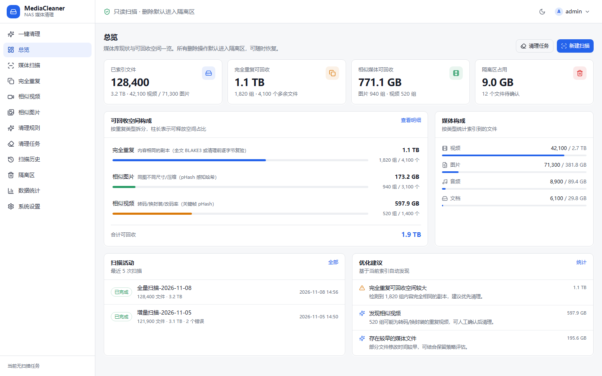
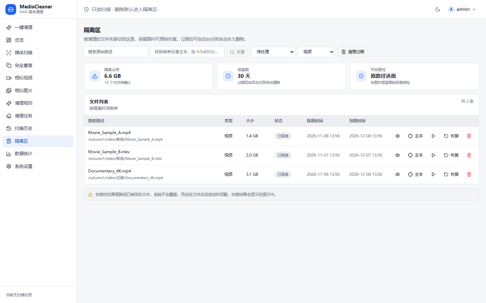
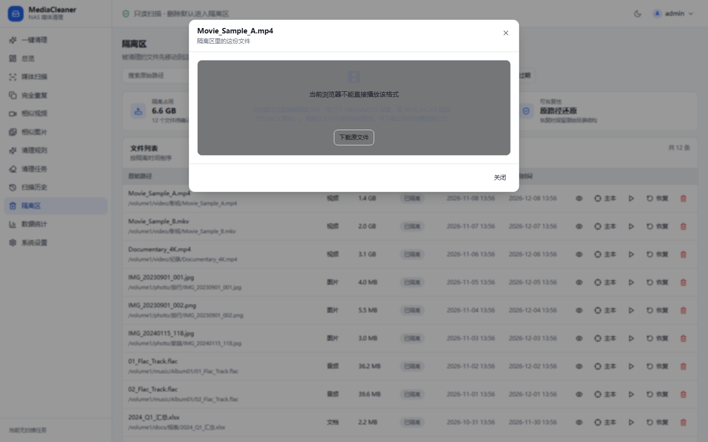

# MediaCleaner Pro

NAS 媒体库去重与清理工具。帮你找出群晖（DSM 6/7）上重复、相似的视频 / 图片 / 文档，**安全地**清理掉多余副本，把省出来的空间还给硬盘——而且**任何一步都能反悔**。

> 删除永远是最后一步，而且默认不是真删除：所有清理动作只会把文件移进**隔离区**保留 30 天，确认无误后再永久清除，期间随时可一键还原到原路径。

---

## ✨ 主要特性

- **三种去重能力，自由组合**
  - 完全重复：同名同内容的精确副本，零解码、极快（10 万文件约 3–8 分钟）
  - 相似图片：感知哈希聚类，找出「看起来一样」的不同分辨率 / 压缩版本
  - 相似视频：ffmpeg 抽帧比对，定位内容重复的视频（可单独开关）
- **隔离区 + 30 天恢复**：清理 = 移动到隔离区，不是删除。原路径被占用时自动追加时间戳，绝不覆盖。
- **按类型筛选隔离项**：视频 / 图片 / 音频 / 文档 / 其他，一眼找到想处理的那一类。
- **预览与确认**：清理前可预览文件，点空白处即可关闭预览弹窗；每个清理任务都要显式点「执行清理」才会动手。
- **总览看板**：重复类型分布、可回收空间、历史任务一目了然。
- **Docker 部署，镜像内置 ffmpeg**：后端 Go 单二进制 + 纯 SQLite，前端 React，一条命令起服务。

---

## 🖼 界面一览

### 总览看板


### 隔离区 · 按类型筛选


### 预览弹窗 · 点空白处关闭


---

## 🚀 快速开始（群晖）

把项目放到 NAS 任意目录（例如 `/volume1/docker/mediacleaner`），SSH 登录后执行一键部署脚本：

```bash
cd /volume1/docker/mediacleaner
sudo bash deploy/synology-deploy.sh
```

- 服务默认运行在 **http://<NAS IP>:8083**
- 运行期数据写到 `/volume1/docker/mediacleaner-data`（可用 `--data-dir` 改到别的卷）
- 源码目录只用于构建，数据与源码分离，更新时不丢数据

打开浏览器访问上面的地址，按界面引导完成三件事即可：

1. **添加媒体卷**：选择要扫描的目录（例如 `/volume1/video`、`/volume1/photo`）。
2. **扫描**：选好去重档位（极速 / 标准 / 深度），开始扫描。
3. **确认清理**：在分组结果里勾选要清掉的副本，进入隔离区；满意后再永久清除。

---

## 🛡 它是怎么保护你的文件的

整个流程是 **扫描 → 分组 → 规则求值 → 人工确认 → 隔离区**，全链路可回滚：

- **不扫描不删**：每个卷默认只索引、不清理，必须手动开启写入权限才会产出清理项。
- **执行前复核**：清理时逐文件校验，大小 / 修改时间变了就跳过，拒绝误删正在变化的文件。
- **保留文件保护**：每组你标记「保留」的文件、以及手动钉住的路径，任何规则都动不了。
- **30 天后悔期**：所有清理进隔离区，原样保留 30 天，随时还原。

---

## ❓ 常见问题

**Q：清理会直接删掉我的文件吗？**
不会。默认只移动到隔离区，30 天内可在「隔离区」页面一键还原到原路径。

**Q：相似视频扫描为什么比较慢？**
只有「深度」档位会解码视频做抽帧比对，耗时与视频时长成正比。不想等可以只用「极速 / 标准」档位。

**Q：误删了怎么办？**
进「隔离区」找到对应文件，点「还原」即可回到原始位置（原路径被占用时自动加时间戳）。

**Q：扫描完数字在哪看？**
「数据统计 / 总览」页面汇总重复类型分布与可回收空间，数字在 Dry Run、看板、实际执行三处保持一致。

**Q：能装在 Windows / Linux 上本地跑吗？**
可以。后端是 Go 单二进制，前端是静态资源，按项目内 Dockerfile / 部署脚本构建即可。

---

## 📄 许可证

本项目仅供个人 NAS 媒体整理使用。请遵守你所在地区关于数据存储与版权的规定，清理他人内容前确认你有权处理。
